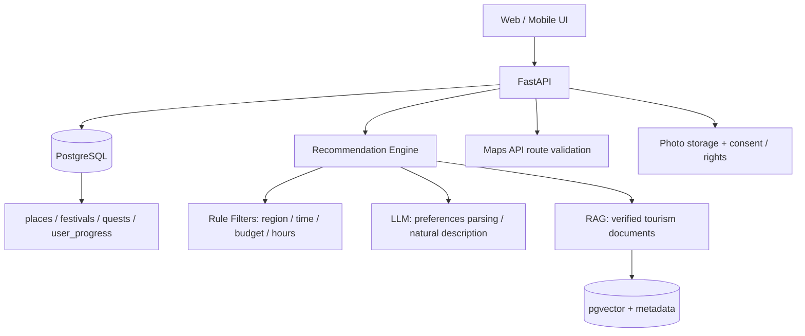

# 시스템 설계 — 현재 vs 목표

## 현재 구현 구조

- `docs/index.html`: HTML/CSS/JavaScript가 한 파일에 포함된 **독립 실행 데모**
- 장소·축제·사진 메타데이터는 프런트 JS에 직접 포함
- 기록·XP·찜·코스는 `localStorage` 저장 (계정 간 동기화 없음)
- 추천은 사용자 입력을 조건으로 **사전 정의된 후보를 필터링·정렬**하는 규칙 기반 방식
- `backend/`: 별도의 **FastAPI 시제품** — 장소/축제 조회, 추천, XP 계산 미리보기. 현재 브라우저와 연결되지 않음

## 향후 목표 아키텍처

**백엔드 연동·실제 로그인·LLM·RAG·지도 연결은 미래 작업입니다.** 다이어그램의 목표 구조를 현재 완성된 시스템으로 오해하지 않도록 구분합니다.

### 추천 요청 처리 (구현 계획)

1. 사용자 문장 → LLM이 JSON 형태로 의도·제약 추출.
2. SQL에서 **권리·운영정보가 확인된 장소**만 추출. 과거 방문·찜·취향 반영.
3. RAG로 허용된 관광 자료·축제·지역 역사 설명 검색, 문서 ID와 확인일 제공.
4. 실제 경로/API로 이동 시간 검증. 총 소요 시간·예산을 초과하는 후보 제거.
5. LLM은 **확인된 place_id 집합 안에서만** 설명·미션 텍스트 생성.
6. 사용자에게 추천 이유·출처·대안 코스 제시.
7. 사용자 현장 방문 인증은 별도 서버 검증: 같은 퀘스트 중복 XP 금지.

### 할루시네이션 대응

- **장소 ID 존재 검사:** 반환 place_id가 DB에 없으면 추천에서 제외.
- **운영시간:** 출처·갱신일 정보가 없으면 ‘방문 전 확인 필요’ 표시.
- **사진:** 검색 결과 사진의 사용 허락을 별도로 확인하고 `place_photos.license` 저장.
- **AI 비용:** 응답 토큰 상한, 사용자별 쿼터, 캐싱 검토.
- **프라이버시:** 위치·업로드 사진 수집 최소화, 보관 기간 및 삭제 기능.

## 데이터 모델

초기 PostgreSQL 설계는 [`database/schema.sql`](database/schema.sql)에 있습니다. 아직 실제 마이그레이션이나 서비스 DB에 적용한 것은 아닙니다.
