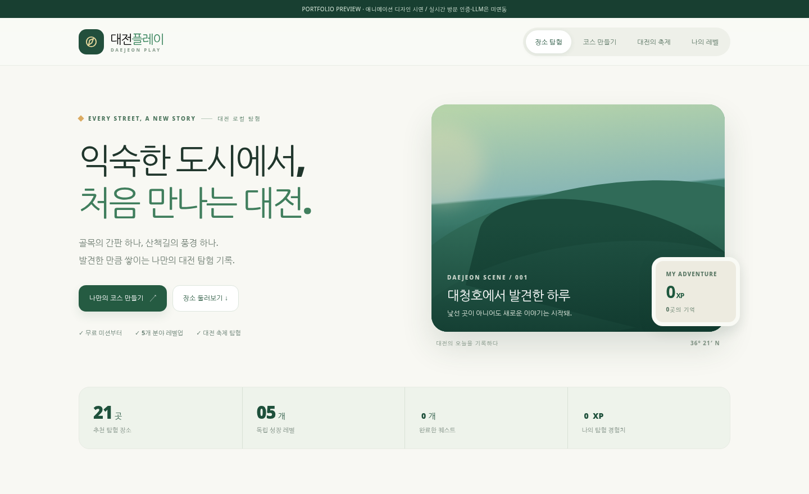
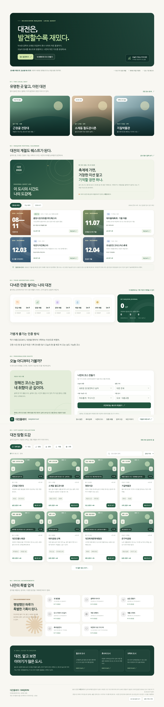
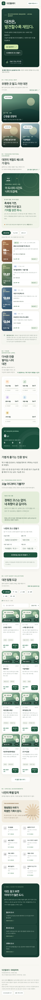
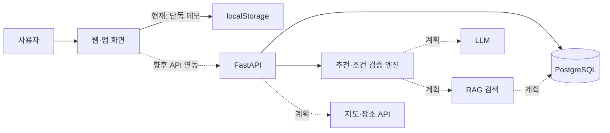

# 대전플레이 — 애니메이션 포트폴리오 시안 (v8)



> **먼저 보기:** GitHub Pages에서 `docs/index.html`을 공개하면 다운로드 없는 인터랙티브 시안을 열 수 있습니다. React/Anime.js/Motion/Bklit UI 연결 소스는 `frontend/` 참고.

**시연과 실제 구현을 구분합니다.** `docs/`는 설치 없는 HTML/CSS/JS 인터랙티브 디자인 데모이고, `frontend/`는 Anime.js·Motion·Bklit UI를 적용하는 React 개발용 소스입니다. 이번 환경의 npm 네트워크 제약으로 React 빌드는 아직 검증하지 못했습니다. AI 추천/실제 방문 인증은 미구현이며, 데모 코스는 규칙 기반입니다.

- [디자인 시연](docs/index.html)
- [React 프론트엔드 실행 방법](frontend/README.md)
- [기존 v7 백업](docs/archive/v7-original.html)

---

# 대전플레이 (DaejeonPlay)

**“대전을 발견하는 일이 하나의 게임이 된다면?”**

대전의 골목 식당, 산책로, 박물관, 과학 문화공간, 축제를 퀘스트처럼 탐험하고 **맛집·탐험·문화·체험·과학** 경험치를 모으는 지역 탐험 프로젝트입니다.

> **프로젝트 상태: MVP 프로토타입 + 초기 API 개발**  
> 웹 데모는 작동하지만, 실제 현장 GPS/사진 인증, 계정·운영 DB, 네이버 API, RAG, LLM 추천은 **아직 연결되지 않았습니다.** 코스 추천은 현재 **규칙 기반**입니다.



**웹 데모: GitHub Pages 배포 후 주소 추가** · [모바일 화면 보기](docs/screenshots/mobile.png) · [기능 개발 계획](PROJECT_ROADMAP.md) · [포트폴리오 작성 초안](PORTFOLIO.md)

## 1. 프로젝트를 시작한 이유

기존 관광 정보는 유명한 명소 중심으로 소비되기 쉽고, 지역 주민에게도 낯선 동네와 소규모 문화공간은 발견하기 어렵습니다. 대전플레이는 **새로운 지역을 발견하는 즐거움**을 퀘스트와 도감, 경험치로 표현하고, 이용자의 취향·시간에 맞는 코스를 제안하는 것을 목표로 합니다.

**검증하고 싶은 가설:** 게임형 미션과 취향 기반 추천을 결합하면, 사용자들이 몰랐던 대전의 장소를 더 쉽게 찾고 방문할 수 있을까? **지역 상권 활성화·방문 증가 효과는 아직 검증하지 않았습니다.**

## 2. 주요 기능과 구현 상태

| 기능 | 상태 | 설명 |
|---|---|---|
| 대전 장소 21곳 탐색 | ✅ 데모 구현 | 장소 분류·지역 필터·검색·설명 |
| 축제/행사 8건 소개 | ✅ 데모 구현 | 2026년 데이터 기반, 현재 일정 확인 필요 |
| 사진 갤러리 | ✅ 데모 구현 | 좌우 넘김, 일부 참고 사진·출처 표시, 사용자가 사진 추가 가능 |
| 사진/외관 미션 | ✅ 데모 구현 | 안내판·간판·외관 한 장 등 가벼운 퀘스트 |
| 5개 분야 XP·레벨 | ✅ 데모 구현 | 중복 완료 처리, 브라우저 로컬 저장 |
| 뱃지·도감 | ✅ 데모 구현 | 활동 조건 충족 시 수집 |
| 코스 추천 | ✅ 데모 구현 | 시간·지역·활동 유형 중심의 규칙 기반 추천 |
| 장소 조회 및 추천 API | ✅ 초기 API | `FastAPI`의 JSON 기반 조회·추천 엔드포인트 (프론트 연동 전) |
| 실제 사용자 로그인·DB 저장 | 📝 계획 | PostgreSQL, 서버 측 권한·중복 인증 제어 |
| 네이버 지도·길찾기 | 📝 계획 | API 키와 약관 확인 후 백엔드 연동 |
| RAG 기반 장소 정보 검색 | 📝 계획 | 허용된 자료+출처+갱신일 기반 검색 |
| LLM 자연어 코스 요청 | 📝 계획 | 조건 추출·설명, 검증된 장소 ID만 사용 |
| 실제 방문 사진/GPS 검증 | 📝 계획 | 사진 동의·보관 정책, 위치 신뢰도 고려 |

*✅는 브라우저에서 동작하는 시연 기능이라는 뜻이며, 실제 방문 검증을 의미하지 않습니다.*

## 3. 스크린샷

| PC | 모바일 |
|---|---|
|  |  |

## 4. 기술 스택

| 영역 | 현재 적용 | 향후 확장 후보 |
|---|---|---|
| Frontend | HTML / CSS / Vanilla JavaScript (단일 파일 MVP) | Next.js + TypeScript |
| API | FastAPI, Pydantic, Python | 인증·권한·캐싱 |
| Data | 장소·행사 JSON, localStorage | PostgreSQL, PostGIS, pgvector |
| AI | — (현재는 규칙 기반 추천) | LLM API + RAG + 추천 랭킹 |
| 지도·미디어 | 장소 검색 링크·외부 이미지 | 네이버 지도 API, 라이선스 확인 사진 |
| 테스트/배포 | pytest, GitHub Actions, GitHub Pages | 별도 API 호스팅·모니터링 |

### 설계 원칙

- **사실과 생성 분리:** 주소·운영시간·예산·실제 이동 시간은 검증 가능한 데이터/API에서 가져오기.
- **RAG 출처 표시:** 생성한 소개 문구와 공식 자료를 구분하고, 자료의 확인 일자를 기록하기.
- **AI 결과 검증:** LLM은 데이터베이스에 존재하는 장소 ID만 추천하게 하고, 시간·동선·예산은 코드로 확인하기.
- **경험치의 무결성:** XP 계산과 중복 지급 제어는 AI가 아닌 서버 측 규칙으로 처리하기.
- **사진 권리:** 검색 결과에서 무단으로 이미지를 복제·재배포하지 않고, 사용 권한 확인 후 등록하기.

## 5. 아키텍처



현재 `docs/index.html` 데모와 `backend/` API는 **분리되어 있으며 아직 연결되지 않았습니다.** AI/DB/API 관련 점선은 **예정된 구조**입니다. [상세 설계](ARCHITECTURE.md)

## 6. 실행하기

### A. 웹 데모 (서버 없이)

`docs/index.html`을 Chrome 또는 Edge에서 열면 됩니다. 이미지가 외부 서버에서 제공되는 경우 인터넷이 필요할 수 있습니다.

로컬 테스트 서버가 필요하면 프로젝트 루트에서:

```bash
python -m http.server 5500 --directory docs
```

브라우저에서 `http://localhost:5500`을 열어 주세요.

### B. FastAPI (별도 실행)

**Windows PowerShell / macOS / Linux 공통:**

```bash
cd backend
python -m venv .venv
# Windows: .venv\Scripts\Activate.ps1
# macOS/Linux: source .venv/bin/activate
python -m pip install -r requirements.txt
uvicorn app.main:app --reload
```

API 문서: `http://127.0.0.1:8000/docs`

```bash
# 프로젝트 루트에서
python -m pytest backend/tests -q
```

**주의:** API 실행만으로 웹 데모가 자동 연동되지는 않습니다. 연동 작업은 차기 단계입니다.

### C. GitHub Pages로 데모 공개

저장소 업로드 후 `Settings → Pages → Build and deployment → Deploy from a branch`에서 **`main` / `/docs`**를 선택합니다.

Pages 주소는 일반적으로 `https://<GitHub-ID>.github.io/<repository-name>/` 형태입니다. 공개 저장소와 배포 설정을 확인하세요.

## 7. 데이터·사진·보안

- 장소 소개와 축제 정보는 **초기 기획용 샘플 데이터**입니다. 운영정보·축제 일정은 방문 전 공식 자료로 재확인해야 합니다.
- 네이버 검색 결과를 RAG 원문으로 무단 저장/가공하지 않습니다. **라이선스가 확인된 관광 자료와 직접 조사·작성한 자료**를 RAG 대상으로 사용합니다.
- 외부 사진 중 **참고 이미지**는 해당 장소의 실제 간판/외관이라고 주장하지 않습니다. [사진 정책](DATA_POLICY.md)
- `.env`와 API 비밀키는 GitHub에 올리지 않습니다. 사진·위치 기록은 동의와 삭제 기능을 포함해 설계합니다.

## 8. 포트폴리오 검증 계획

| 검증 항목 | 측정 방법 | 현재 결과 |
|---|---|---|
| 첫 방문 장소 발견률 | 탐험 전후 새로 알게 된 장소 수 | **미측정** |
| 코스 적합성 | 시간·지역·유형 조건 위반률 | **현장 미측정** |
| 추천 만족도 | 사용 후 5점 평가 | **미측정** |
| AI 근거 정확도 | 추천의 출처 일치율·할루시네이션 사례 | **AI 미연결** |
| API 안정성 | 단위 테스트 및 요청 응답 검증 | **초기 테스트 포함** |

[측정 계획](TEST_PLAN.md) · [로드맵](PROJECT_ROADMAP.md) · [개발 일지](DEVLOG.md)

## 9. 내가 맡은 역할

> 이 저장소는 개인 포트폴리오용 초안입니다. 실제로 수행한 역할·수정 이력·테스트 결과를 기록하여 채워 나가세요. AI가 생성한 초안이나 외부 데이터 작업을 전부 직접 개발했다고 서술하지 않습니다.

- **기획:** 문제 정의, 사용자 시나리오, 퀘스트·XP 규칙 수립
- **구현:** UI, 데이터 구조, 추천 규칙, FastAPI 기능 등 실제 수정한 부분 기록
- **검증:** 테스트 케이스, 현장 확인, 사용자 인터뷰, 개선 전후 비교 기록

---

**현재 버전:** v0.1 · 데모 중심 · 2026-11-04 시작
